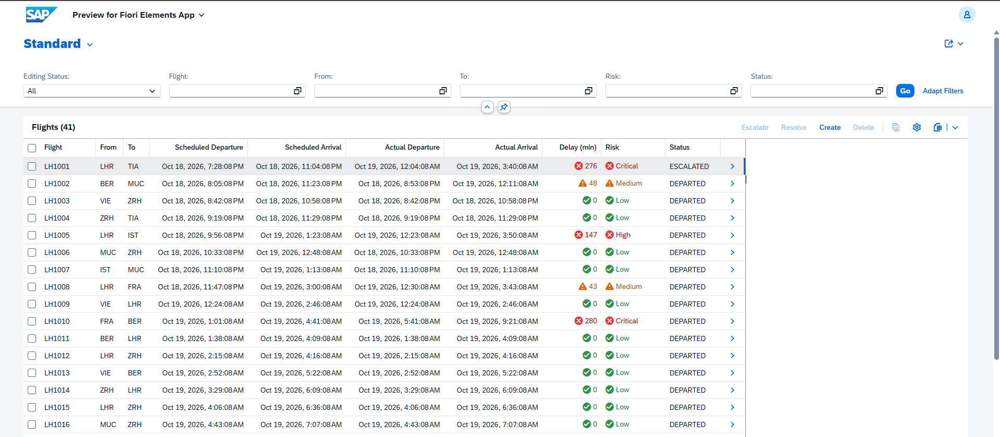
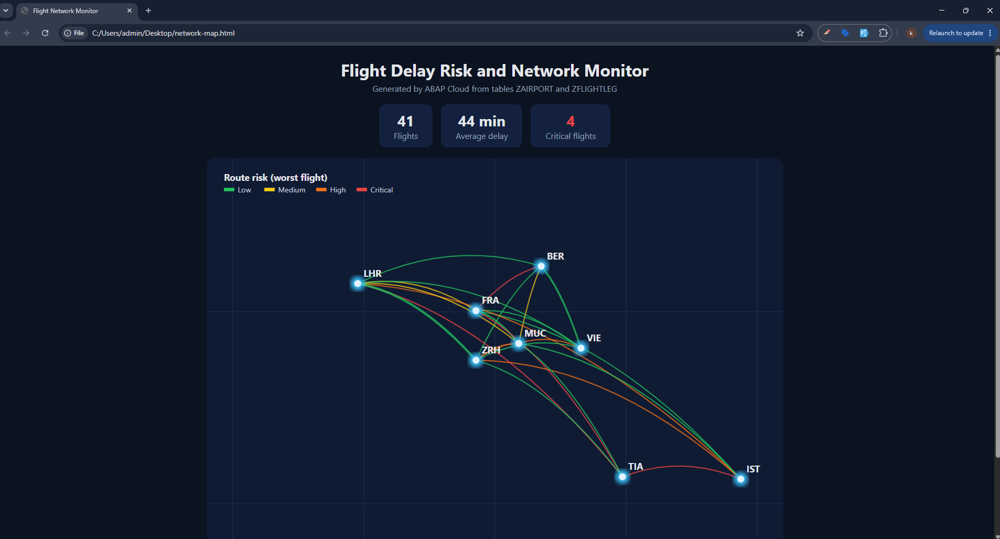
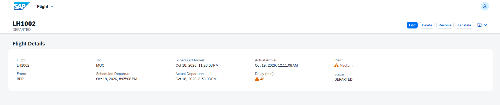
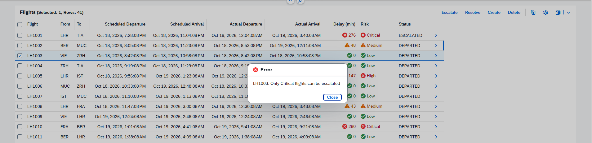

[README.md](https://github.com/user-attachments/files/33678644/README.md)
# Flight Delay Risk & Network Monitor

A small but complete **SAP ABAP Cloud / RAP** application on **SAP BTP (ABAP environment, trial)**.
It tracks flight legs, calculates delay and risk automatically, lets an operator escalate
critical flights, and draws an airport network map generated by ABAP.

Built to practice the full ABAP Cloud stack end to end: tables, CDS, a managed RAP business
object with draft, a Fiori Elements UI and an ABAP-generated visualisation.

> The data is generated test data (no real flights). Built in Eclipse ADT.

## Screenshots

| Fiori list report (risk colours) | Network map (ABAP-generated) |
|---|---|
|  |  |

| Validation error | Escalate action |
|---|---|
|  |  |

(Add your own screenshots to `docs/screenshots/` with these names.)

## What it does

- **Flights** are stored in `ZFLIGHTLEG`, **airports** (with latitude/longitude) in `ZAIRPORT`.
- When the actual departure is entered, the app **calculates the delay in minutes** and
  a **risk level** (Low < 15 min, Medium < 60, High < 180, Critical otherwise).
- **Validations** stop bad data: arrival must be after departure; origin and destination
  must exist in the airport master data and must differ.
- **Actions**: *Escalate* (only allowed for Critical flights) and *Resolve*.
- The UI shows the risk with **colours** (green / yellow / red) and has filters for flight,
  airports, risk and status.
- A class generates a **network map** (SVG): arcs between airports, coloured by the worst
  risk on the route, thicker when more flights use it.

## Architecture

```
ZAIRPORT, ZFLIGHTLEG (+ ZFLIGHTLEG_D draft table)
        |
ZR_FLIGHTLEG  CDS root view entity (calculated RiskCriticality)
        |            behavior definition ZR_FLIGHTLEG (managed, draft, strict(2))
        |            behavior pool ZBP_R_FLIGHTLEG (determinations, validations, actions)
ZC_FLIGHTLEG  CDS projection view + metadata extension (UI annotations)
        |
ZUI_FLIGHTLEG  service definition -> ZUI_FLIGHTLEG_O4 service binding (OData V4 - UI)
        |
Fiori Elements List Report / Object Page (preview from the service binding)

ZCL_FLIGHT_MAP  reads both tables, builds the SVG network map
```

## Repository contents

| Folder | Content |
|---|---|
| `src/tables` | DDIC tables `ZAIRPORT`, `ZFLIGHTLEG` |
| `src/cds` | Root view `ZR_FLIGHTLEG`, projection `ZC_FLIGHTLEG` |
| `src/behavior` | Behavior definition `ZR_FLIGHTLEG` |
| `src/classes` | Behavior pool `ZBP_R_FLIGHTLEG`, data generators, `ZCL_FLIGHT_MAP` |
| `src/ui` | Metadata extension with the Fiori Elements annotations |

Objects created by the RAP generator and not copied here: draft table `ZFLIGHTLEG_D`
(needs one extra column `riskcriticality : abap.int1`), the projection behavior definition
(`use action escalate; use action resolve;` added), service definition and service binding.

## How to run it

1. Create the package `ZFLIGHTOPS` and the two tables, then activate them.
2. Run `ZCL_AIRPORT_GENERATOR` and `ZCL_FLIGHTLEG_GENERATOR` with F9 (Run as ABAP Application).
3. Generate the RAP objects for `ZFLIGHTLEG` (OData UI Service), then apply the files in `src/`.
4. Publish `ZUI_FLIGHTLEG_O4` and press *Preview*.
5. For the map, run `ZCL_FLIGHT_MAP` with F9 and save the console output as an `.html` file.

## What I learned / problems I solved

- **Draft tables must contain every field of the entity**, including calculated ones.
  Adding `RiskCriticality` to the CDS view made the behavior definition fail until the
  draft table got the same column.
- **Behavior handler classes belong in the Local Types** tab of the behavior pool.
- **Field labels** in Fiori Elements come from `@EndUserText.label` in the metadata extension.
- **UCON blocks custom HTTP services** called directly from a browser in ABAP Cloud, so the
  map page is exported through the console. A live version needs a communication scenario
  and arrangement.
- `utclong` and `utclong_diff` make time calculations simple compared to old date/time fields.

## Tech

ABAP Cloud, RAP (managed, draft, strict mode 2), CDS view entities, EML,
OData V4, Fiori Elements, ABAP Development Tools (Eclipse), SAP BTP trial.
